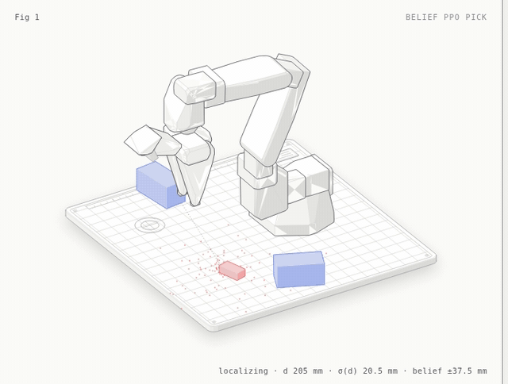

# Pick-and-Place under Uncertainty (SO-ARM101)

An SO-ARM101 arm in MuJoCo must pick up a red LEGO brick and place it on a goal. It can only see the brick through a noisy wrist camera, and two taller blue bricks block the view. The project compares reinforcement learning agents with and without memory or a belief, along with a planner, all on the same task.



The red dots are the particle filter's guesses about where the brick is. As the camera closes in, the cloud shrinks. Once it is tight, the arm commits to a grasp, lifts the brick by friction and places it on the goal.

ASEN 5264 Decision Making under Uncertainty, University of Colorado Boulder. Author: Allen Devaraj Augustin Ponraj. The original course submission is at tag `v1-course-submission`.

## Results

The setup: 3 training seeds per method, with 200 shared evaluation episodes at each of 6 camera-noise levels. The full write-up is in [`docs/report.md`](docs/report.md).


| Method | IQM success | 95% CI | Grasp error at 10 mm noise |
|---|---|---|---|
| Oracle PPO (sees the true pose) | 0.73 | 0.68–0.77 | 6.8 mm |
| **Belief PPO** (particle filter) | **0.44** | 0.42–0.45 | **10.5 mm** |
| Plain PPO (latest reading only) | 0.36 | 0.34–0.37 | 12.4 mm |
| Frame-stack PPO (last 4 readings) | 0.33 | 0.32–0.35 | 13.6 mm |

- **Belief PPO** beats plain and frame-stack PPO at every noise level. The gap is largest at 15 mm (0.42 vs 0.30 for plain PPO).
- **Where the gain comes from:** its grasp position is 2–5 mm closer to the brick's true centre. That matters because the gripper only tolerates about ±6 mm.
- **Frame-stacking hurts:** a raw window of past readings does worse than a single reading above 5 mm of noise.

**Planning** (10 mm noise, 50 shared episodes):

| Planner | Success | CPU per decision |
|---|---|---|
| POMCP in exact physics, 32 simulations | **0.68** | 1.0 s |
| Belief PPO, same episodes | 0.41 | < 1 ms |
| POMCP with a learned world model, 32 simulations | 0.40 | 8 ms |

- **Search in exact physics** comes within 0.05 of the oracle.
- **Search in the learned model** does worse as the search budget grows (0.40 at 32 simulations, 0.24 at 512).

## The task

- **Control:** the policy runs at 10 Hz. It moves the gripper (±15 mm per step) and its yaw, and decides when to commit to a grasp.
- **Grasp:** committing runs a physical top-down grasp. If the brick is held, a scripted place carries it to the goal.
- **Limits:** each episode allows up to 3 grasp attempts and 20 s of sim time.
- **Camera noise:** grows with distance (σ ∝ d), so closer readings are better.
  - Training samples the noise level from 2–20 mm.
  - Evaluation uses 2, 5, 10, 15, 20 and 30 mm.

## Quick start

```bash
bash setup_venv.sh     # isolated .venv: mujoco 3.6, SB3 2.7.1, sb3-contrib, rliable, torch CPU
./vpy -m pytest -q     # 92 tests
```

Train one method and seed, then evaluate and make the figures:

```bash
./vpy -m pomdp_pick.agents.train --method belief --seed 0 --config configs/train_v21.yaml --out runs_v21
./vpy -m pomdp_pick.eval.evaluate --runs runs_v21 --episodes 200
./vpy -m pomdp_pick.eval.evaluate_pomcp --sims 32 128 --episodes 50 --out-dir runs_v21/eval
./vpy tools/make_results.py --runs runs_v21 --tag v21
```

To rerun the full study, use `./vpy tools/run_queue.py configs/queue_v21.json` and `configs/queue_pomcp.json`. The queue runs one job at a time under a watchdog (`tools/watchdog.py`). The watchdog pauses the job if the laptop runs hot, low on memory or on battery.

## Layout

```
pomdp_pick/robot/     MuJoCo model, IK, grasp and place controller
pomdp_pick/sensing/   wrist camera visibility and noise
pomdp_pick/belief/    particle filter over brick pose and noise level
pomdp_pick/envs/      PickPlaceEnv
pomdp_pick/agents/    methods, training
pomdp_pick/eval/      evaluation, statistics, figures
pomdp_pick/planning/  POMCP and the learned world model
tools/                watchdog, run queue, results
docs/                 report, training log, design notes
vla_SO-ARM101/        v1 ROS 2 + MoveIt stack (robot meshes and URDF)
```

## License

MIT
