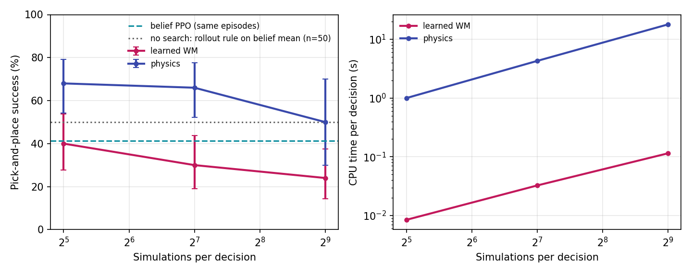

# Pick-and-place under uncertainty — SO-ARM101

An SO-ARM101 arm in MuJoCo has to pick a red LEGO brick and place it on a goal while its wrist camera is noisy, two taller blue bricks block the view, and the brick drifts. The project compares memoryless, memory-based, belief-based and planning agents on exactly the same task.

> **v2 (this branch, `revamp`)** rebuilds the course project as a rigorous simulation study:
> - real physical grasping: jaw pads, friction, actuated joints
> - one shared reward for all methods
> - multi-seed results with confidence intervals
>
> The original ASEN 5264 course submission is preserved at git tag **`v1-course-submission`**.

## Results

These are the v2.1 numbers: 3 training seeds per method, 200 shared evaluation episodes at each of 6 noise levels. The full write-up is in [`docs/report.md`](docs/report.md).


| method | IQM success | 95% CI | commit error @ 10 mm |
|---|---|---|---|
| Oracle PPO (sees the true pose) | 0.73 | 0.68–0.77 | 6.8 mm |
| **Belief PPO** (particle filter) | **0.44** | 0.42–0.45 | **10.5 mm** |
| Plain PPO (latest reading) | 0.36 | 0.34–0.37 | 12.4 mm |
| Frame-stack PPO (last 4 readings) | 0.33 | 0.32–0.35 | 13.6 mm |

**Belief beats memory:**
- Belief PPO beats plain and frame-stack PPO at every noise level. Its worst seed beats plain's best.
- The gap is largest at 15 mm: 0.42 vs 0.30.
- It comes from commit precision: with about ±6 mm of physical grasp tolerance, 2–5 mm less error decides the grasp.
- A raw window of readings (frame-stack) is *worse* than a single reading above 5 mm.

**Training reliability was the first bottleneck:**
- Without a curriculum, belief PPO collapsed into "never commit" on 2 of 3 seeds, and recurrent PPO on 3 of 3.
- v2.1 adds one identical, training-only grasp-assist curriculum for every method. It decays to zero by mid-training.
- With it, no run collapsed, at a cost of about 0.1 oracle success.
- Both protocols are reported (report §4.1–4.2).

**Planning (σ = 10 mm, 50 shared episodes):**



| planner | success | CPU per decision |
|---|---|---|
| Physics POMCP, 32 simulations | **0.68** | 1.0 s |
| Rollout rule on belief mean (no search) | 0.50 | < 1 ms |
| WM-POMCP (learned model), 32 simulations | 0.40 | 8 ms |
| Belief PPO, same episodes | 0.41 | < 1 ms |

- **Search in exact physics** gets within 0.05 of the oracle.
- **A learned world model gets worse the harder you search it** (0.40 → 0.24 at 512 simulations). It predicts the gripper with R² 0.98, but only the *average* belief update (R² 0.05–0.6), and search exploits that error.
- **More physics search did not help either** (0.68 → 0.66 → 0.50). The open-loop tree does not value the readings it will get.

## What changed from v1

| | v1 (course project) | v2 |
|---|---|---|
| Grasp | 15 mm XY proximity check; brick slides along the table | Physical top-down grasp: jaw box pads squeeze the brick, it lifts by friction |
| Robot | Joint angles teleported each step | Position-actuated joints with gravity compensation, 4 ms physics |
| Camera | Aimed at the true target (privileged) | Real wrist-camera pose; frustum + occlusion decide visibility |
| Reward | Differed by method (belief-only σ bonus, reward on noisy obs) | Identical for every method, from the true state, potential-based shaping |
| Belief | Fixed likelihood width (collapsed at 2× training noise) | Particle filter jointly estimates the brick pose and the camera noise level |
| Baselines | Plain PPO vs belief PPO | Oracle, plain, frame-stack, recurrent (LSTM), belief PPO; POMCP |
| Statistics | 1 training seed, 100 episodes | Multiple seeds, shared eval seeds, IQM + bootstrap CIs (rliable), Wilson intervals |

## The task (v2)

- **Control:** 10 Hz. The policy moves the jaw-centre point P (±15 mm per step) and the gripper yaw, and decides when to commit.
- **Commit:** runs a physical grasp (open, descend, close, lift 5 cm). If the brick is held, a scripted physical place carries it to the known goal.
- **Grasp tolerance** (measured): roughly ±6 mm across the jaw axis, so localization matters. Misses physically shove the brick.
- **Wrist camera noise:** σ(d) = σ_ep · d / 10 cm, clipped to [0.3, 3]·σ_ep. Being closer means clearer readings.
  - Training: σ_ep log-uniform over 2–20 mm.
  - Evaluation: 2, 5, 10, 15, 20 and 30 mm (30 is out of distribution).
- **Budget:** 20 s of sim time per episode, at most 3 grasp attempts.

## Quick start

```bash
bash setup_venv.sh          # isolated .venv (pinned: mujoco 3.6, SB3 2.7.1, sb3-contrib, rliable, torch CPU)
./vpy -m pytest -q          # 91 tests; ./vpy runs the venv python without the ROS PYTHONPATH
```

Train one method and seed. Checkpoints are written every 100k steps and runs resume automatically:

```bash
./vpy -m pomdp_pick.agents.train --method belief --seed 0 --config configs/train_v21.yaml --out runs_v21
```

Run a queue unattended. Jobs run one at a time, at `nice 19`, under the thermal/memory/battery watchdog:

```bash
nohup ./vpy tools/run_queue.py configs/queue_phase1.json > runs/queue.out 2>&1 &
```

Evaluate with shared seeds, then compute statistics and figures:

```bash
./vpy -m pomdp_pick.eval.evaluate --runs runs_v21 --episodes 200
./vpy -m pomdp_pick.eval.evaluate_pomcp --sims 32 128 --episodes 50 --out-dir runs_v21/eval
./vpy tools/make_results.py --runs runs_v21 --tag v21     # tables + figures → docs/results_v21.md
```

## Laptop-safe compute

Everything long-running goes through `tools/watchdog.py`. It pauses (SIGSTOP) the job's whole process group when any of these hold:

- the 30 s average CPU package temperature is above 85 °C, or any instantaneous reading is ≥ 95 °C;
- free memory is under 2 GB;
- the laptop is on battery.

It resumes once the average is back below 75 °C. Stopping the watchdog never leaves a frozen job behind. Training uses a single env worker, because this 28 W laptop is thermally limited (see `docs/training-log.md`).

## Layout

```
pomdp_pick/robot/     model builder (pads, actuators, camera site), IK/FK, grasp/place controller
pomdp_pick/sensing/   wrist camera visibility + noise, occlusion geometry
pomdp_pick/belief/    particle filter over (x, y, θ, log σ_ep)
pomdp_pick/envs/      PickPlaceEnv (oracle / plain / belief observations)
pomdp_pick/agents/    method registry, training, evaluation policy wrapper
pomdp_pick/eval/      shared-seed evaluation, statistics, figures, POMCP evaluation
pomdp_pick/planning/  POMCP (exact physics snapshots), learned world model, WM-POMCP
pomdp_pick/footage/   episode recorder + MuJoCo renderer (follow cam, wrist-cam inset, belief overlay)
tools/                watchdog, run queue, throughput benchmark
docs/                 design spec, implementation plans, training log
vla_SO-ARM101/        v1 legacy: ROS 2 Humble + MoveIt 2 control stack and GUI (unchanged; robot meshes/URDF live here)
```

## Status

- **Done:**
  - v2 env and harness
  - the v2.1 RL matrix (4 methods × 3 seeds) with its 200-episode evaluation
  - the POMCP / WM-POMCP budget study, a no-search ablation and world-model accuracy
  - the report: [`docs/report.md`](docs/report.md), with generated tables in [`docs/results_v21.md`](docs/results_v21.md)
- **Reproduce the results:**
  1. `./vpy tools/run_queue.py configs/queue_v21.json`
  2. `./vpy tools/run_queue.py configs/queue_pomcp.json`
  3. `./vpy tools/make_results.py --runs runs_v21 --tag v21`

Progress and every design decision are logged in [`docs/training-log.md`](docs/training-log.md). The design is in [`docs/superpowers/specs/2026-10-07-revamp-design.md`](docs/superpowers/specs/2026-10-07-revamp-design.md).
