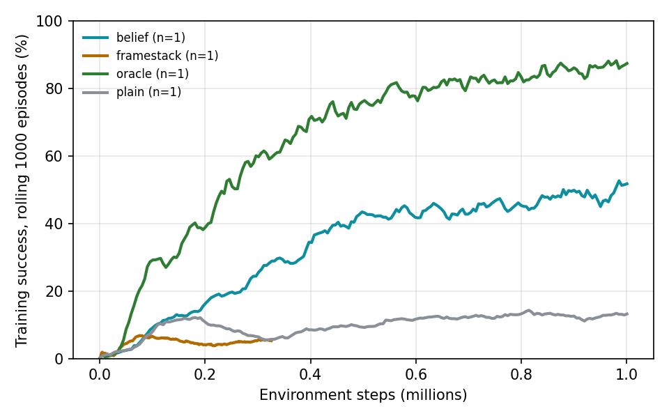

# v2 results (generated by `tools/make_results.py`)

## Training curves

| method     |   n_seeds |   final |
|:-----------|----------:|--------:|
| belief     |         1 |   0.518 |
| framestack |         1 |   0.053 |
| oracle     |         1 |   0.875 |
| plain      |         1 |   0.132 |
