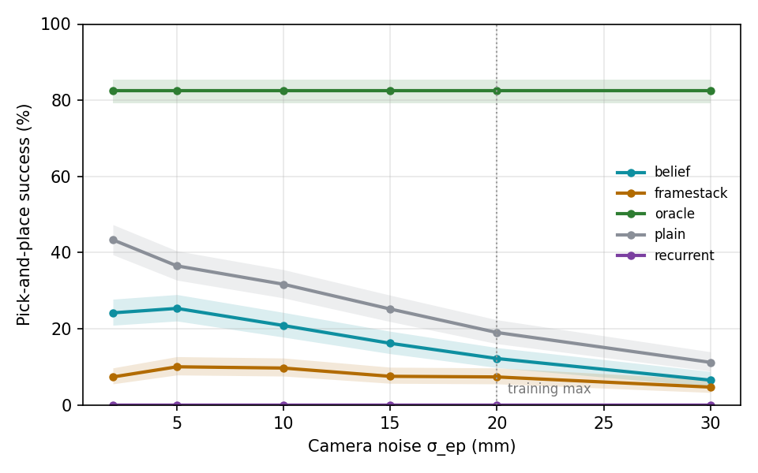

# v2 results (generated by `tools/make_results.py`)

## Training curves

| method     |   n_seeds |   final |
|:-----------|----------:|--------:|
| belief     |         3 |   0.234 |
| framestack |         3 |   0.121 |
| oracle     |         3 |   0.774 |
| plain      |         3 |   0.340 |
| recurrent  |         3 |   0.004 |

## Success vs camera noise (200 episodes per σ per seed, shared seeds)

| method | seeds | σ=2 mm | σ=5 mm | σ=10 mm | σ=15 mm | σ=20 mm | σ=30 mm |
|---|---|---|---|---|---|---|---|
| oracle | 3 | 0.82 [0.79–0.85] | 0.82 [0.79–0.85] | 0.82 [0.79–0.85] | 0.82 [0.79–0.85] | 0.82 [0.79–0.85] | 0.82 [0.79–0.85] |
| belief | 3 | 0.24 [0.21–0.28] | 0.25 [0.22–0.29] | 0.21 [0.18–0.24] | 0.16 [0.13–0.19] | 0.12 [0.10–0.15] | 0.07 [0.05–0.09] |
| recurrent | 3 | 0.00 [0.00–0.01] | 0.00 [0.00–0.01] | 0.00 [0.00–0.01] | 0.00 [0.00–0.01] | 0.00 [0.00–0.01] | 0.00 [0.00–0.01] |
| framestack | 3 | 0.07 [0.06–0.10] | 0.10 [0.08–0.13] | 0.10 [0.08–0.12] | 0.07 [0.06–0.10] | 0.07 [0.06–0.10] | 0.05 [0.03–0.07] |
| plain | 3 | 0.43 [0.39–0.47] | 0.36 [0.33–0.40] | 0.32 [0.28–0.35] | 0.25 [0.22–0.29] | 0.19 [0.16–0.22] | 0.11 [0.09–0.14] |

| method | IQM success (seeds × σ) | 95% CI |
|---|---|---|
| oracle | 0.847 | 0.754–0.907 |
| belief | 0.096 | 0.023–0.249 |
| recurrent | 0.000 | 0.000–0.000 |
| framestack | 0.080 | 0.046–0.106 |
| plain | 0.266 | 0.192–0.338 |

| comparison | P(improvement) | 95% CI |
|---|---|---|
| P(belief > oracle) | 0.000 | 0.000–0.000 |
| P(belief > recurrent) | 0.806 | 0.694–0.917 |
| P(belief > framestack) | 0.426 | 0.222–0.648 |
| P(belief > plain) | 0.306 | 0.111–0.519 |

### Mean commit error (mm)

| method     |    2 |    5 |   10 |   15 |   20 |   30 |
|:-----------|-----:|-----:|-----:|-----:|-----:|-----:|
| belief     |  6.9 |  7.4 | 10   | 12.1 | 14.7 | 19.1 |
| framestack | 24.5 | 24.1 | 24.4 | 27.3 | 29.5 | 34.2 |
| oracle     |  6.9 |  6.9 |  6.9 |  6.9 |  6.9 |  6.9 |
| plain      | 10.7 | 12.1 | 14.6 | 18.1 | 20.7 | 26.6 |
| recurrent  | 16.9 | 26.4 | 35.7 | 40.9 | 40.4 | 45.8 |
