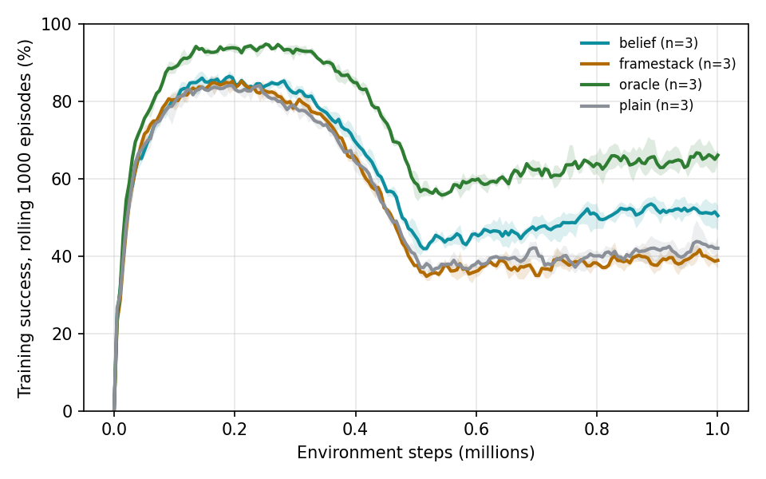
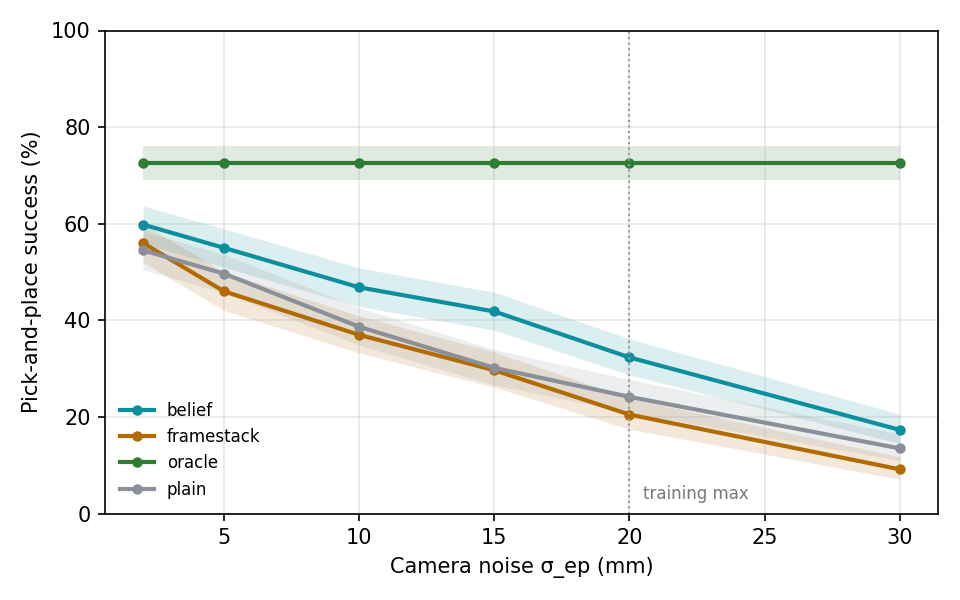

# v2 results (generated by `tools/make_results.py`)

## Training curves

| method     |   n_seeds |   final |
|:-----------|----------:|--------:|
| belief     |         3 |   0.505 |
| framestack |         3 |   0.389 |
| oracle     |         3 |   0.662 |
| plain      |         3 |   0.421 |

## Success vs camera noise (200 episodes per σ per seed, shared seeds)

| method | seeds | σ=2 mm | σ=5 mm | σ=10 mm | σ=15 mm | σ=20 mm | σ=30 mm |
|---|---|---|---|---|---|---|---|
| oracle | 3 | 0.73 [0.69–0.76] | 0.73 [0.69–0.76] | 0.73 [0.69–0.76] | 0.73 [0.69–0.76] | 0.73 [0.69–0.76] | 0.73 [0.69–0.76] |
| belief | 3 | 0.60 [0.56–0.64] | 0.55 [0.51–0.59] | 0.47 [0.43–0.51] | 0.42 [0.38–0.46] | 0.32 [0.29–0.36] | 0.17 [0.15–0.21] |
| framestack | 3 | 0.56 [0.52–0.60] | 0.46 [0.42–0.50] | 0.37 [0.33–0.41] | 0.30 [0.26–0.33] | 0.20 [0.17–0.24] | 0.09 [0.07–0.12] |
| plain | 3 | 0.55 [0.50–0.58] | 0.50 [0.46–0.54] | 0.39 [0.35–0.43] | 0.30 [0.27–0.34] | 0.24 [0.21–0.28] | 0.14 [0.11–0.16] |

| method | IQM success (seeds × σ) | 95% CI |
|---|---|---|
| oracle | 0.728 | 0.682–0.772 |
| belief | 0.435 | 0.420–0.452 |
| framestack | 0.332 | 0.316–0.349 |
| plain | 0.357 | 0.342–0.370 |

| comparison | P(improvement) | 95% CI |
|---|---|---|
| P(belief > oracle) | 0.019 | 0.000–0.074 |
| P(belief > framestack) | 0.944 | 0.833–1.000 |
| P(belief > plain) | 0.889 | 0.759–0.991 |

### Mean commit error (mm)

| method     |   2 |    5 |   10 |   15 |   20 |   30 |
|:-----------|----:|-----:|-----:|-----:|-----:|-----:|
| belief     | 7.6 |  8.3 | 10.5 | 12.5 | 14.2 | 19.5 |
| framestack | 9.2 | 10.8 | 13.6 | 16.7 | 20.2 | 26.4 |
| oracle     | 6.8 |  6.8 |  6.8 |  6.8 |  6.8 |  6.8 |
| plain      | 7.9 |  9.4 | 12.4 | 14.7 | 17.2 | 22.4 |
